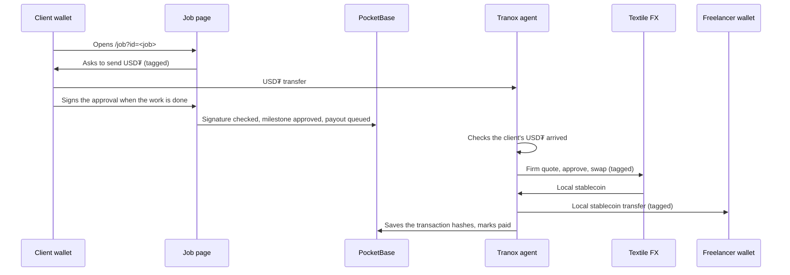

# Tranox

Tranox is an agent that pays freelancers in their own local currency on Celo. A client pays a job milestone in dollars (USD₮); Tranox converts it on Textile FX and sends the freelancer naira, rupiah, pesos or reais as a stablecoin (cNGN, IDRX, wARS, wMXN, wCOP or wBRL), straight to their phone wallet.

Built for Celo's Agents Open for Business hackathon, Stablecoin Corridors track.

Live at **https://tranoxweb.com**.

## The problem

A freelancer in Lagos or Jakarta who works for a client abroad usually gets paid in dollars through a bank wire or a payout platform. The money takes days to arrive, fees come off at each step, and then they still have to change dollars into the money they spend.

With Tranox the client pays in USD₮, and the freelancer receives their own currency in MiniPay or Valora a few minutes after the milestone is approved. The conversion happens on-chain at a firm Textile FX quote, and every step has a public transaction link.

## How it works



1. Each job has the client's wallet (`client_wallet`). The client opens the job page in MiniPay or any Celo wallet and pays each milestone in USD₮ to the agent wallet. The page adds the attribution tag to the payment.
2. When the work is done, the client approves the milestone on the same page by signing a short message with that wallet (free, no transaction). The web server checks the signature belongs to the job's `client_wallet`, then marks the milestone approved, and a PocketBase hook queues a payout in the same database transaction. Approval is refused if the freelancer or job is missing a wallet.
3. The freelancer follows every payout on their own page, with the amount in their currency and the transaction links.
4. The worker (`npm run worker`) picks up the payout. It first checks on-chain that this client has sent enough USD₮ to cover it. If not, the payout waits.
5. The worker gets a firm Textile FX quote, approves and swaps USD₮ into the freelancer's currency, then sends it to the freelancer. Every transaction carries the tag `celo_37620e33107f`.
6. The transaction hashes are written back to the payout record.

## Safety rules

- **Only known wallets get paid.** Freelancer wallets must be on `FREELANCER_ALLOWLIST` in `.env`, added after confirming each wallet with the freelancer directly. A changed profile in the database cannot redirect a payout.
- **No payout without the client's money.** A milestone payout starts only when the client's wallet has sent the agent enough USD₮ for it and all of that client's earlier payouts.
- **Spending limits.** `MAX_PAYOUT_USDT` per payout and `MAX_DAILY_USDT` per UTC day, counted from the chain and the database, so restarts do not reset them.
- **Safe after a crash.** Each payout records the block where it started. After a crash the worker checks the chain: a finished transfer marks it paid, a finished swap gets its transfer sent, and nothing sent puts it back in the queue. New payouts wait until every stuck one is settled.
- **One worker at a time.** A lock in PocketBase stops two workers paying the same payout.
- **Retries that follow Textile's docs.** No quote, an expired quote, a swap rejected on-chain, and Textile errors 429, 500, 502 and 503 are retried. A payout gives up after `MAX_QUEUE_HOURS`, or after 3 rejected swaps.

## Code layout

| Path | What it does |
| --- | --- |
| `src/wallet.ts` | The only place transactions are sent; adds the attribution tag to every one |
| `src/textile.ts` | Textile FX quotes, approval, swap and reporting the swap back |
| `src/payout.ts` | Converts and pays one payout, with the spending limits and allowlist |
| `src/funding.ts` | Checks the client's USD₮ has arrived |
| `src/worker.ts` | Runs queued payouts, retries, and crash recovery |
| `src/recover.ts`, `src/db.ts` | Works out from the chain what happened to a stuck payout |
| `pocketbase/pb_migrations` | Database tables: freelancers, jobs, milestones, payouts, worker_locks |
| `pocketbase/pb_hooks` | Queues a payout when a milestone is approved |
| `src/web.ts`, `src/views.ts` | Public web server: the pages and the only data they can see |
| `src/approval.ts` | The approval message and the client wallet signature check |
| `web/` | Home page, client job page, freelancer payout page |
| `scripts/` | Wallet, balances, quotes, agent registration, test payout |

## Run it

You need Node 22 and [PocketBase 0.40.6](https://github.com/pocketbase/pocketbase/releases) for your system. Everything runs on Celo mainnet, so steps marked **real money** spend real funds.

### 1. Install and configure

```bash
npm install
cp .env.example .env
npm run wallet:new        # prints a new agent key; put it in .env as AGENT_PRIVATE_KEY
```

Unzip PocketBase into `pocketbase/bin`, then create a database admin and put the same email and password in `.env`:

```bash
npm run pb -- superuser upsert <email> <password>
npm run pb                # starts PocketBase on http://127.0.0.1:8090 and applies the tables and hooks
```

Main `.env` settings:

| Setting | Meaning |
| --- | --- |
| `AGENT_PRIVATE_KEY` | The agent wallet key. Never share or commit it |
| `CELO_ATTRIBUTION_TAG` | `celo_37620e33107f` |
| `FREELANCER_ALLOWLIST` | Comma-separated freelancer wallets allowed to receive payouts. Empty means no payouts |
| `MAX_PAYOUT_USDT`, `MAX_DAILY_USDT` | Spending limits in USD₮ |
| `MAX_QUEUE_HOURS` | How long a payout may wait for liquidity before it fails |
| `POCKETBASE_URL`, `POCKETBASE_ADMIN_EMAIL`, `POCKETBASE_ADMIN_PASSWORD` | Database connection |

### 2. Fund the agent and check prices

Send the agent wallet, on the Celo network:

- **About 0.5 CELO for gas.** At the gas price on 21 Nov 2026, registering the agent is estimated at about 0.05 CELO and one full payout (approve, swap, transfer) at about 0.09 CELO, with generous gas limits, so 0.5 CELO covers registration and about 5 payouts.
- **1 USD₮ for a test payout, or none.** Real payouts are funded by the client from the job page; the agent only spends its own USD₮ in `swap:test`. Textile quoted swaps as small as 1 USD₮ on 21 Nov.

Then:

```bash
npm run balances          # agent wallet balances
npm run quote -- 5        # live Textile FX prices and depth for every currency
```

### 3. Pay a milestone

1. In the PocketBase admin (`http://127.0.0.1:8090/_/`), add a **freelancer** with their wallet and payout currency, and add that wallet to `FREELANCER_ALLOWLIST`. The freelancer's wallet must be one that can show their local stablecoin, such as MetaMask on the Celo network. MiniPay only shows USD₮, USDC and USDm, so cNGN, IDRX and the wFIAT tokens sent there are safe but invisible. The freelancer page has a button that asks the wallet to add the token, and the token address to add by hand. MetaMask refused cNGN from the page in one test.
2. Add a **job** for that freelancer with the client's wallet in `client_wallet`.
3. Add a **milestone** with the amount in USD₮, at least 1 USD₮ (the smallest swap Textile FX quotes). It starts as `pending`.
4. Put the pages online (see below). Send the client `https://<public address>/job?id=<job id>` and the freelancer `https://<public address>/freelancer?id=<freelancer id>`.
5. The client pays the milestone from that page with the job's wallet. **Real money.**
6. When the work is done, the client presses **Approve milestone** and signs. A payout appears in `payouts` as `queued`.
7. Start the worker. **Real money.**

   ```bash
   npm run worker
   ```

   The payout moves to `paid` with the swap and payout transaction hashes. Until the client's USD₮ arrives, its `error` field says how much is still needed.

To test one payout without a client, `npm run swap:test -- <freelancer wallet> IDRX 1` converts 1 USD₮ from the agent's own funds and pays it out. Pick a currency that `npm run quote -- 1` shows with makers online. **Real money.**

### Put the pages online

Clients and freelancers open their pages from their phones, so the pages must be reachable from the internet. Never expose PocketBase itself: its admin page and records would be public. Instead, run the Tranox web server (`npm run web`). It serves only the pages and four routes, keeps PocketBase private, and answers everything else with "not found":

| Route | What it does |
| --- | --- |
| `GET /api/jobs/<id>` | The job page's data: milestones, statuses, today's rate, the wallets to pay from and to |
| `GET /api/freelancers/<id>` | The freelancer page's data: payouts, local amounts, transaction links |
| `POST /api/milestones/<id>/challenge` | The exact approval message to sign |
| `POST /api/milestones/<id>/approve` | Checks the client's signature, then approves the milestone. Limited to 20 requests a minute per visitor |

Run each in its own terminal:

```bash
npm run pb       # PocketBase on 127.0.0.1:8090
npm run web      # Tranox pages on 127.0.0.1:8091
cloudflared tunnel --url http://127.0.0.1:8091
```

The last command needs [cloudflared](https://developers.cloudflare.com/cloudflare-one/connections/connect-networks/downloads/) (on Windows: `winget install Cloudflare.cloudflared`). It prints a public address like `https://<random words>.trycloudflare.com`; page links are that address plus `/job?id=<job id>` or `/freelancer?id=<freelancer id>`, and the address alone is the home page.

This free quick tunnel needs no account, but it is for testing: the address changes every time it restarts (links sent earlier stop working), and it only works while this computer runs all three commands. For a lasting address, run the same web server on a small always-on server, or use a named Cloudflare tunnel.

### 4. Register the agent

Host `agent-card.json` at a public URL, set `AGENT_CARD_URI` in `.env`, then run `npm run register:agent` to register on the ERC-8004 identity registry. **Real money** (gas only).

## Production

| Part | Runs on | Address |
| --- | --- | --- |
| Pages and data routes (`web/`, `api/index.ts`, `src/router.ts`) | Vercel, project `tranox` | https://tranoxweb.com |
| PocketBase and the payout worker | Google Compute Engine e2-micro `tranox-api`, us-central1, systemd services `tranox-pb` and `tranox-worker` | https://api.tranoxweb.com |

- The live worker runs on the Google server, with the agent's private key. The key is also kept on the founder's laptop for manual runs. It is not in the repo. Vercel holds only the agent's public address (`AGENT_ADDRESS`) and a separate PocketBase login used only by the website.
- Caddy serves `api.tranoxweb.com` with an automatic Let's Encrypt certificate and passes on only `/api/*`; the PocketBase admin page is not reachable from the internet. PocketBase rate limits are on.
- Deploy the pages with `vercel deploy --prod`. Update the server with `git pull` in `/opt/tranox/app`, then `sudo systemctl restart tranox-pb tranox-worker`.
- Only one worker may run against a database. Do not start a local worker while the server's worker is running.

## Liquidity

Textile FX depth changes with the makers online. On 20 Nov 2026, for 5 USD₮: cNGN and IDRX had over 40,000 USD₮ of depth, wBRL about 9.80 and wCOP about 7.66, wARS had no valid quote and wMXN had no makers online. On 21 Nov, for 1 USD₮: IDRX and wARS had thousands of USD₮ of depth, wBRL about 4.02 and wCOP about 6.71, and cNGN and wMXN had no makers online. Run `npm run quote -- <amount>` before paying in a thin currency; the worker also checks depth and waits if there is not enough.

## Celo mainnet addresses

| | Address |
| --- | --- |
| USD₮ | `0x48065fbBE25f71C9282ddf5e1cD6D6A887483D5e` |
| cNGN | `0xF6829D7393dAe24509eb1E52eE8e572e2E271a4f` |
| IDRX | `0x18Bc5bcC660cf2B9cE3cd51a404aFe1a0cBD3C22` |
| wARS | `0x0DC4F92879B7670e5f4e4e6e3c801D229129D90D` |
| wBRL | `0xD76f5Faf6888e24D9F04Bf92a0c8B921FE4390e0` |
| wMXN | `0x337E7456B420bD3481e7FA61fA9850343d610d34` |
| wCOP | `0x8a1D45e102e886510e891d2Ec656a708991e2D76` |
| Textile reactor | `0xa9AA0a64769cBed4d3B1Ceb4Df01CdE915C235b3` |
| ERC-8004 Identity Registry | `0x8004A169FB4a3325136EB29fA0ceB6D2e539a432` |

## Hackathon details

- Attribution tag: `celo_37620e33107f`
- Agent wallet: [`0xB1eF0cEa020B273E1c30370a787B9447DfE14706`](https://celoscan.io/address/0xB1eF0cEa020B273E1c30370a787B9447DfE14706)
- ERC-8004 agent ID: `10085` on the Celo identity registry, registered 21 Nov 2026 ([transaction](https://celoscan.io/tx/0xe2f7143fbcf41ba8d18d5b29ab92ef64fa65dbb13b9bcb60389aeb3ffb8b3d1e), [8004scan](https://8004scan.io))
- Self Agent ID: `210` (Self Agent Registry on Celo mainnet)
- Tagged transactions:
  - Agent registration, tag `celo_37620e33107f` verified: [0xe2f7143f...](https://celoscan.io/tx/0xe2f7143fbcf41ba8d18d5b29ab92ef64fa65dbb13b9bcb60389aeb3ffb8b3d1e)
  - Client payment from MiniPay through the job page, 0.05 USD₮, tagged by the page: [0x3d6f3415...](https://celoscan.io/tx/0x3d6f3415eb3201bde488c4de31f638a5a15e73d03e141d07cbc8b92abda67c45)
  - Our own test run, no client, 21 Nov 2026: 1 USD₮ converted on Textile FX to 18,350.35 IDRX and sent to a freelancer wallet, all tagged. USD₮ approval [0x7e4fbbe9...](https://celoscan.io/tx/0x7e4fbbe99cf24a9269834821e4ebd8959e638717079161024fb72ea4c94ac82e), swap [0xeabac923...](https://celoscan.io/tx/0xeabac9235657087c5219b0df07e445e578d25da9401a8bb4b55036ba16bdf993), payout [0x2ea6b85d...](https://celoscan.io/tx/0x2ea6b85d3ac9907c79ab61674cb21dd47a3109567b7bc8aeaa9ef20413a56178)
  - First full milestone through the job page, founder as client, 22 Nov 2026 ("Project documentation", 1 USD₮ to Barok): client payment from MiniPay [0x8c0c5332...](https://celoscan.io/tx/0x8c0c53322b1595fa8a54349824a608d304dbcd2baee5a3d91db5fd5a2940308d), swap to 18,343.62 IDRX [0x8bd24a0b...](https://celoscan.io/tx/0x8bd24a0b0ab51c9899284bf34c51aeb8ba564a8966c2ce70867ee4a8aa955b74), payout [0x6d0de440...](https://celoscan.io/tx/0x6d0de440990be68dc635c5dea5f1860a5274874f4fe9c988d50746b67474a75d), all tagged
  - Second milestone, founder as client, 22 Nov 2026 ("Documentation update", 1 USD₮ to Barok, paid 23 seconds after approval): client payment from MiniPay [0xb8bd00dd...](https://celoscan.io/tx/0xb8bd00ddf90a66ab49719f4b7b8fd0ad62fba6b03e901eb09628272618e59bd5), USD₮ approval [0x803ceed2...](https://celoscan.io/tx/0x803ceed2e98df03c84c4025a4ced1e2fa5e53197996839ee6205d126dcb933c3), swap to 18,360.13 IDRX [0x33706707...](https://celoscan.io/tx/0x337067070276cb0b583028aa2a15471b3c825355369c05440cfd0ff9a0e949e4), payout [0x9b1f0bc7...](https://celoscan.io/tx/0x9b1f0bc7e85bed1e9edd028001c5949874499e4e72bb44367cf2b61a3ec33636), all tagged. The agent topped up the client wallet with 0.7 USD₮ first [0x30e11cb4...](https://celoscan.io/tx/0x30e11cb40a3f256ea4ce0fc9239b3915806fac483a78839f2e6e6a30ec01aff3).
  - Francis in Accra pays Godwin in Port Harcourt, 23 Nov 2026 ("App screen fix", 1 USD₮ to 1,455.06 cNGN, paid 35 seconds after approval): client payment [0x40507e88...](https://celoscan.io/tx/0x40507e888c273ff724bfc9af92cd72710f42d4feed02ee23fc01fb4ed1c11305), approval [0xe9e3df3e...](https://celoscan.io/tx/0xe9e3df3e7386215a18f874d21a9e25e3892ec8068d8e66e7a247d092adbc3dac), swap [0x764896db...](https://celoscan.io/tx/0x764896dbab69a3d6cb973cb0ca4c711ed1f039c1695f1ea08dbb74623fc23ffb), payout [0xc8123fbf...](https://celoscan.io/tx/0xc8123fbfa64bfa1af430b472c914880502d136d574e2fca08c5aad55cf1eae06), all tagged
